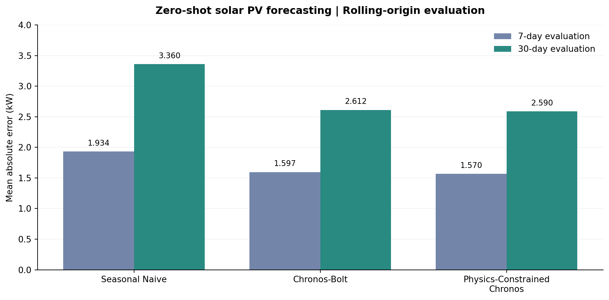
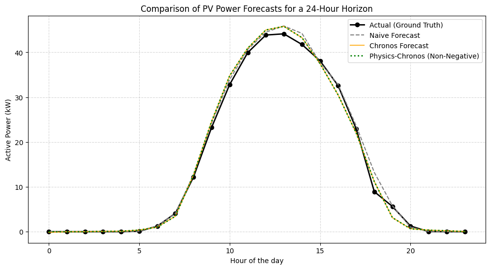
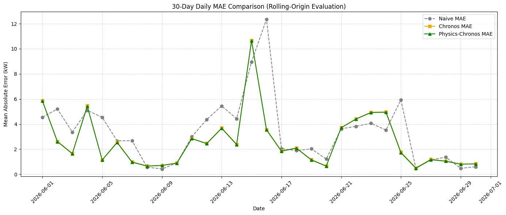

# Solar PV Forecasting with a Time-Series Foundation Model



> **Question:** Can a pretrained time-series foundation model forecast solar PV generation **without task-specific training**, and can a simple physical constraint improve its output?

This miniature research project benchmarks **Amazon Chronos-Bolt-Tiny** on measured hourly PV generation from **Site A** of the [Two-Site Solar PV Inverter & Weather Dataset (Romania)](https://github.com/upb-nlp/PV-Generation-Dataset). A 14-day historical context is used to predict the following 24 hours, with **rolling-origin evaluation** over 7 and 30 forecast days.

**What it demonstrates:** pretrained model inference (zero-shot forecasting), time-series evaluation without future-data leakage, a strong interpretable baseline, and physically motivated post-processing. **No foundation model is trained from scratch or fine-tuned.**

## Results

| Method | 7-day MAE (kW) | 30-day MAE (kW) |
|:--|--:|--:|
| Seasonal Naive (previous day) | 1.9338 | 3.3604 |
| Chronos-Bolt-Tiny (zero-shot) | 1.5968 | 2.6122 |
| **Chronos + non-negativity constraint** | **1.5699** | **2.5896** |

- **7-day:** constrained Chronos achieved **18.82% lower MAE** than seasonal naive; raw Chronos reduced MAE by **17.43%**.
- **30-day:** constrained Chronos achieved **22.94% lower MAE** than seasonal naive; raw Chronos reduced MAE by **22.27%**.
- The non-negativity constraint improved raw Chronos by **1.68%** (7-day) and **0.87%** (30-day).

These are the *actual saved outputs of the supplied notebook*, **not newly rerun experiments**. The 7-day window is nested inside the last 30 days, so they are not independent comparisons.

## Method

1. Load public hourly AC PV output (`active_power_kw`, kW) from Site A.
2. For each forecast day, provide Chronos-Bolt-Tiny with the **previous 336 hours** of observed data and predict the next **24 hours** using the median forecast (0.5 quantile).
3. Compare the model's forecasts with **seasonal naive**, which repeats the last 24 observed hours.
4. Apply the physical non-negativity rule:

   ```python
   physics_forecast = np.maximum(chronos_forecast, 0)
   ```

5. Calculate hourly MAE for each forecast day and average across the **7-day** and **30-day** evaluations.

The 30-day experiment is **30 consecutive 24-hour-ahead forecasts**, not a single 720-hour-horizon forecast. Newly observed ground truth is available between forecast origins. The model is kept frozen throughout.

## Visual results

**Actual vs predicted — final day of the seven-day evaluation:**



**Day-by-day MAE for the 30-day backtest:**



## Reproduce

**Environment:** Python 3.10+ suggested, with PyTorch, `chronos-forecasting`, NumPy, pandas, and Matplotlib. CPU inference; no GPU needed. The pretrained model is downloaded from Hugging Face and the hourly data are downloaded from the source GitHub repository on first run.

```bash
# From the repository root
python -m pip install -r requirements.txt
jupyter notebook notebooks/solar_chronos_zero_shot.ipynb
```

Alternatively, open the notebook in Google Colab and install the dependencies there. **Run all cells from top to bottom.** The input CSV is downloaded live, so changes to the upstream dataset or model/library versions may affect results.

## Files

```text
.
├── README.md
├── requirements.txt
├── .gitignore
├── notebooks/
│   └── solar_chronos_zero_shot.ipynb
└── results/
    ├── mae_summary.csv
    ├── mae_comparison.png
    ├── final_day_forecast.png
    └── daily_mae_30_days.png
```

## Limitations

- Results concern **one Romanian PV site** and at most **30 June 2026 daily forecast origins**, so external validity across seasons and geographies is unknown.
- MAE is **all-hours**, including zero-production nighttime hours. Daylight-only MAE is a worthwhile next experiment.
- Clipping negative values is an **output constraint**, not physics-informed neural network training. It does **not** enforce daylight-only production or a rated-power ceiling.
- The target is inverter AC active power; the non-negative assumption is specific to the chosen target, not necessarily net grid exchange in general.
- The model uses **historical power only**, even though the source dataset also contains weather features.
- Seasonal naive is a useful simple reference, **not** a representative set of trained domain-specific forecasting models.
- The provenance of the foundation model's pretraining data was not audited for overlap with the evaluation dataset.

## Data and model attribution

- **Dataset:** Linca, N.-R., Rebedea, T.-E., Ruseti, S., & Dascalu, M. (2026). *Two-Site Solar PV Inverter & Weather Dataset (Romania)*. [Repository](https://github.com/upb-nlp/PV-Generation-Dataset). Source data: **CC BY 4.0**; data are linked rather than redistributed here.
- **Foundation model:** Amazon, [Chronos-Bolt-Tiny](https://huggingface.co/amazon/chronos-bolt-tiny), [Chronos forecasting repository](https://github.com/amazon-science/chronos-forecasting). Model license: **Apache 2.0**.

## Scope

This is a small demonstration of **evaluating and applying** a pretrained time-series foundation model in an energy systems task, not an implementation or pretraining of a new foundation model.
